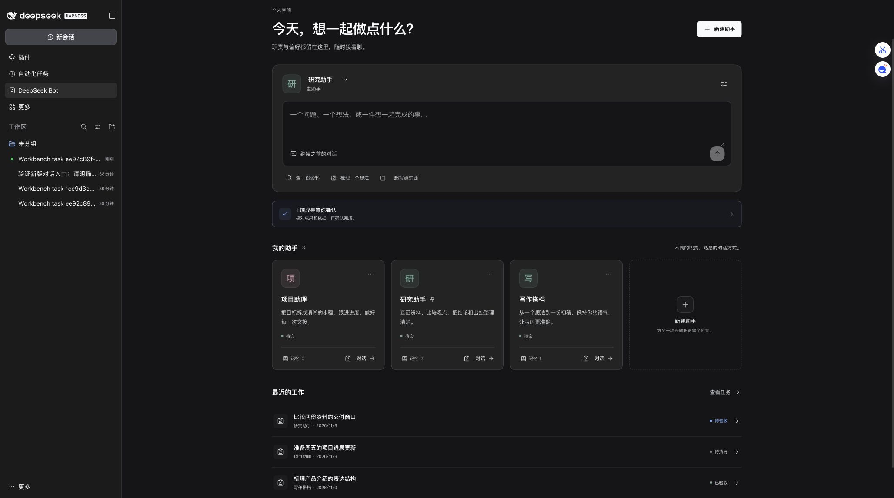

# DeepSeek Bot Workbench

English · [中文](README.md)

A community extension for DeepSeek Harness: persistent personal Bots, private memory, evidence-based task acceptance, explicit handoffs and interrupted-run reconciliation. Not an official DeepSeek product.

**0.1.0-rc.1 is a prerelease. Tested compatibility is limited to Harness 0.2.2-rc.1 and Node.js ≥24.9.0.**



Create and edit Bots, pause or archive them, set a primary Bot, reference native capability presets and optionally select a model route. Open a persistent main conversation or assign a separate task with explicit acceptance criteria. Model-proposed memory remains inactive until confirmed. Search, edit, forget or explicitly share memory as a candidate.

Results and human acceptance are separate. Review each criterion against its evidence, accept it or request changes; the next execution receives that feedback. Native schedules support daily times with an explicit time zone or intervals. Delivery acknowledgment, task receipt, execution and acceptance remain distinct. An interrupted run is never automatically replayed. Transfers create paused copies without sessions, schedules, execution history or acceptance authority.

## Install

Download the prebuilt `.tgz` and `SHA256SUMS.txt` from the [release](https://github.com/RoketrP/dsh-bot-workbench/releases/tag/v0.1.0-rc.1). Verify the checksum, then add its absolute local path through Harness Plugins and enable it. CLI alternative:

```sh
dsh plugin --profile desktop add /absolute/path/dsh-bot-workbench-0.1.0-rc.1.tgz
```

No source compilation or compatibility exemption is required. Other Host versions are unverified.

Create a Bot with an existing workspace. Leave model references blank to follow Harness defaults; never enter API keys. Add a task, run it, inspect its original native session and evidence, then review each criterion. Use native approvals where the current access mode requires them. The extension does not change that access mode.

The Host must remain running. Private memory and workspaces are not security boundaries. Workbench tasks serialize per Bot and resolved workspace; ordinary conversations and other plugins are outside this mutex. Default task limits: two concurrent tasks, 40 steps and 600 seconds. Token counts are Host-reported usage, not bills or hard spending limits. A prior result must be reviewed or reconciled before another scheduled execution is claimed.

[DSH-Bot](https://github.com/MJ-CJM/DSH-Bot) covers overlapping personal-Bot features, and [goal-acceptance](https://github.com/cckyros/goal-acceptance) covers overlapping acceptance features. This project combines Bot-private memory, evidence review, explicit handoff, native schedule receipt binding and interrupted-run reconciliation in one native UI workflow. It does not implement autonomous group chat or external messaging. See [decisions](docs/decisions.md), [verification](docs/verification.md), [operations and data](docs/operations.md), [changelog](CHANGELOG.md) and [security](SECURITY.md). Scripted-model, real-model, browser, desktop and package-install evidence are reported separately.

## Develop

```sh
npm ci --ignore-scripts
npm run check
npm run format:check
mkdir -p dist
npm run pack:plugin
```

Native tests require a separately installed matching Harness. Set `DSH_TEST_CLI` as described in the verification document and run `npm run test:native`. Tests use isolated profiles and a scripted model with zero real model requests.

[MIT](LICENSE) · [Third-party notices](THIRD_PARTY_NOTICES.md)
