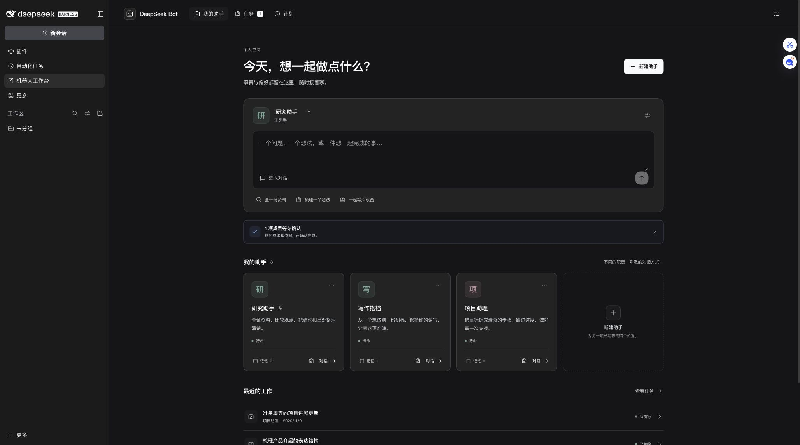

# DeepSeek Bot Workbench

[English](README.en.md) · 中文

DeepSeek Harness 的社区扩展：给个人 Bot 配置长期职责和私有记忆，用任务卡记录交办、证据、人工验收、交接与中断核对。非 DeepSeek 官方产品。

**当前版本：0.1.0-rc.1，预发布。仅声明兼容 Harness 0.2.2-rc.1、Node.js ≥24.9.0。**



## 可以做什么

- 创建、编辑、暂停、归档和恢复 Bot，设置主 Bot；选择原生能力预设、工作目录和可选模型引用。
- 进入长期主会话，或交办有明确目标和验收项的独立任务。
- 每个 Bot 的记忆独立保存；模型提出的候选需确认才生效。支持搜索、修改、遗忘及明确共享为候选。
- 模型提交摘要与逐项证据；人工逐项核对后接受，或提出修改意见。下一轮带入修改意见。
- 使用原生每日或间隔计划，显示时区、原生投递和任务领取；投递、执行结束与验收分别记录。
- 显式交接任务，只传递填写的上下文，不自动复制整库私有记忆。
- 中断运行停在“需要核对”，不自动重放不确定动作。
- 导出完整记录，或预览后导入为暂停副本。导入不恢复会话、计划、运行或验收权限。

它与 [DSH-Bot](https://github.com/MJ-CJM/DSH-Bot) 等现有项目有基础功能重叠。本项目的重点是**证据验收、明确交接、中断核对**；不提供多 Bot 自主群聊或外部 IM。实现选择与归属见[设计决策](docs/decisions.md)。

## 安装

从 [GitHub Release](https://github.com/RoketrP/dsh-bot-workbench/releases/tag/v0.1.0-rc.1) 下载预构建 `.tgz` 和 `SHA256SUMS.txt`，核对校验值后，在 Harness「插件 → 添加插件 → 安装第三方插件」填写下载包的绝对路径，安装并启用。

也可通过官方 CLI 安装到你指定的 profile：

```sh
dsh plugin --profile desktop add /absolute/path/dsh-bot-workbench-0.1.0-rc.1.tgz
```

只安装发布包即可，无需在使用者机器上编译本插件。不要为安装本插件开启全局版本豁免。其他宿主版本尚未验证。

## 第一次使用

1. 在侧栏打开「DeepSeek Bot」，创建 Bot，填写职责和已存在的专用工作目录。模型引用留空时跟随 Harness 默认配置；不填写密钥。
2. 点击助手卡片的「记忆」，保存一条非敏感偏好，打开 Bot 对话检查效果。
3. 在「任务」页新建任务，写清交付结果，每行填写一个验收标准，开始执行。
4. 需要审批时打开原会话，通过 Harness 原生审批处理。插件不改变原有访问模式。
5. 检查摘要、文件或来源，逐项勾选再接受。引用由模型提出，可能不准确。
6. 单次结果通过后再创建计划。前次待验收或结果不确定时，新计划投递不会领取新任务；它不是无限无人值守循环。

电脑和 Host 需持续运行。Bot 的目录和记忆划分不是文件、账号或浏览器权限隔离。同一 Bot 和同一实际工作目录中的工作台任务串行；普通原生会话及其他插件不受此互斥约束。默认任务限制为全局并发 2、40 步、600 秒；用量是宿主报告的 token，不是费用账单或硬预算。

## 验证与数据

[验证矩阵与复现方法](docs/verification.md) · [使用、数据与卸载](docs/operations.md) · [界面结构](docs/design.md) · [更新记录](CHANGELOG.md) · [安全反馈](SECURITY.md)

测试区分脚本化模型、真实 DeepSeek 模型、Web 界面、桌面版和具体发布包；以验证矩阵中的版本和结果为准。市场申请、CI、合并与实际可见是不同状态。

## 开发

```sh
npm ci --ignore-scripts
npm run check
npm run format:check
mkdir -p dist
npm run pack:plugin
```

原生集成测试另需同版本 Harness，按验证文档设置 `DSH_TEST_CLI` 后运行 `npm run test:native`。测试自动建立隔离 profile，不读取个人会话或调用真实模型。开发数据、认证链接和完整日志不得提交。

[MIT 许可证](LICENSE) · [第三方署名与许可证](THIRD_PARTY_NOTICES.md)
